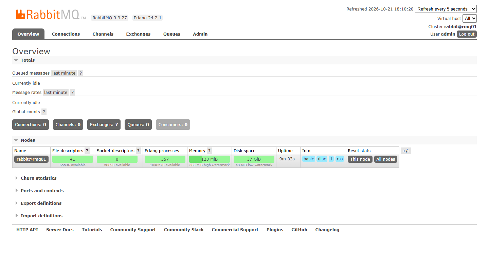
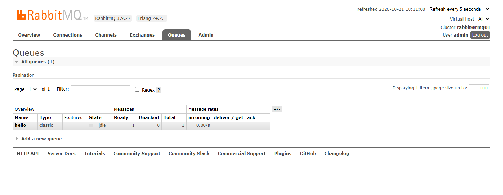
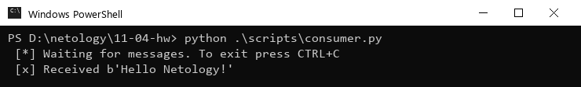
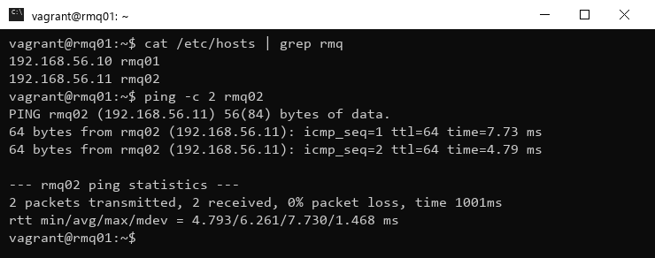
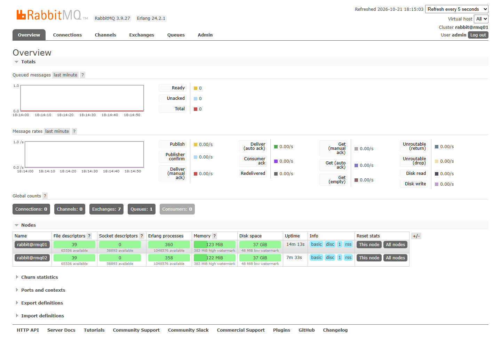
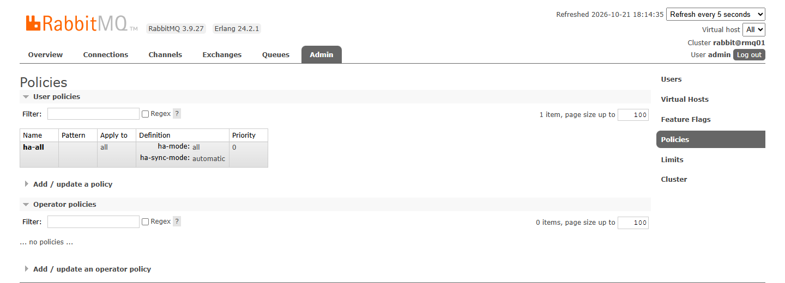
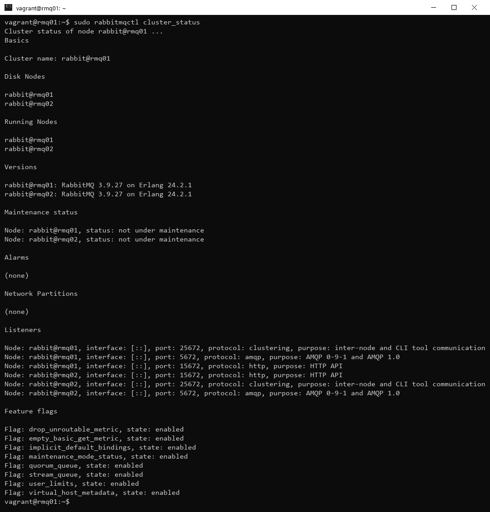
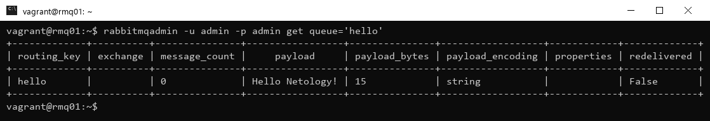
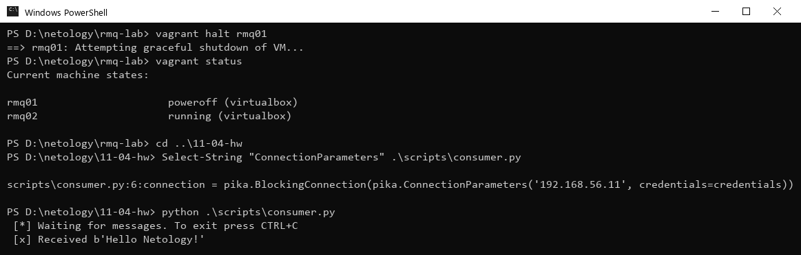
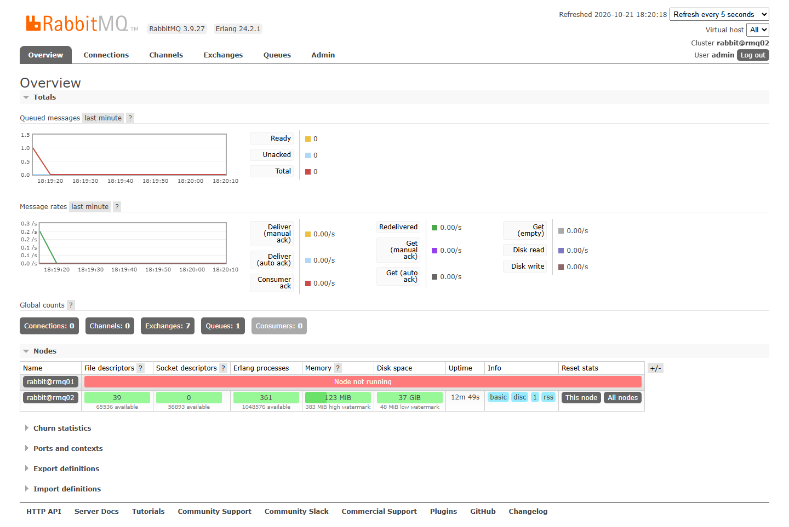

# Домашнее задание к занятию «Очереди RabbitMQ»

### Выполнил: Шушнов Александр

---

## Стенд

Две виртуальные машины в VirtualBox, поднятые через Vagrant ([Vagrantfile](Vagrantfile)):

| Хост | IP | ОС | RabbitMQ / Erlang |
| --- | --- | --- | --- |
| rmq01 | 192.168.56.10 | Ubuntu 22.04 | 3.9.27 / 24.2.1 |
| rmq02 | 192.168.56.11 | Ubuntu 22.04 | 3.9.27 / 24.2.1 |

Provision каждой машины: запись хостов в `/etc/hosts`, установка `rabbitmq-server`, одинаковый `.erlang.cookie`
(нужен для объединения в кластер), включение `rabbitmq_management` и создание пользователя `admin`
(пользователю `guest` подключаться не с localhost запрещено).

---

## Задание 1. Установка RabbitMQ

```bash
apt install rabbitmq-server
rabbitmq-plugins enable rabbitmq_management
rabbitmqctl add_user admin admin
rabbitmqctl set_user_tags admin administrator
rabbitmqctl set_permissions -p / admin ".*" ".*" ".*"
```

Веб-интерфейс `http://192.168.56.10:15672`:



---

## Задание 2. Отправка и получение сообщений

Скрипты запускаются с хостовой машины (Python 3.12, `pip install pika`, pika 1.4.4). В скриптах указан IP `rmq01`
и учётка `admin`; `consumer.py` поправлен под API pika 1.x (`basic_consume(queue=..., on_message_callback=..., auto_ack=True)`).

[producer.py](scripts/producer.py), [consumer.py](scripts/consumer.py)

После запуска `producer.py` в веб-интерфейсе появилась очередь `hello` с одним сообщением:



Результат работы `consumer.py`:



---

## Задание 3. Подготовка HA кластера

Имена и адреса обеих машин прописаны в `/etc/hosts` (делается в provision Vagrantfile), машины пингуются по имени:



`.erlang.cookie` на обеих нодах одинаковый. Подключение `rmq02` к кластеру и создание политики `ha-all`:

```bash
# на rmq02
rabbitmqctl stop_app
rabbitmqctl reset
rabbitmqctl join_cluster rabbit@rmq01
rabbitmqctl start_app

# на любой ноде
rabbitmqctl set_policy ha-all "" '{"ha-mode":"all","ha-sync-mode":"automatic"}'
```

Ноды кластера в веб-интерфейсе:



Политика `ha-all`:



Вывод `rabbitmqctl cluster_status` на rmq01:



<details>
<summary>текстом</summary>

```
vagrant@rmq01:~$ sudo rabbitmqctl cluster_status
Cluster status of node rabbit@rmq01 ...
Basics

Cluster name: rabbit@rmq01

Disk Nodes

rabbit@rmq01
rabbit@rmq02

Running Nodes

rabbit@rmq01
rabbit@rmq02

Versions

rabbit@rmq01: RabbitMQ 3.9.27 on Erlang 24.2.1
rabbit@rmq02: RabbitMQ 3.9.27 on Erlang 24.2.1

Maintenance status

Node: rabbit@rmq01, status: not under maintenance
Node: rabbit@rmq02, status: not under maintenance

Alarms

(none)

Network Partitions

(none)

Listeners

Node: rabbit@rmq01, interface: [::], port: 25672, protocol: clustering, purpose: inter-node and CLI tool communication
Node: rabbit@rmq01, interface: [::], port: 5672, protocol: amqp, purpose: AMQP 0-9-1 and AMQP 1.0
Node: rabbit@rmq01, interface: [::], port: 15672, protocol: http, purpose: HTTP API
Node: rabbit@rmq02, interface: [::], port: 15672, protocol: http, purpose: HTTP API
Node: rabbit@rmq02, interface: [::], port: 25672, protocol: clustering, purpose: inter-node and CLI tool communication
Node: rabbit@rmq02, interface: [::], port: 5672, protocol: amqp, purpose: AMQP 0-9-1 and AMQP 1.0

Feature flags

Flag: drop_unroutable_metric, state: enabled
Flag: empty_basic_get_metric, state: enabled
Flag: implicit_default_bindings, state: enabled
Flag: maintenance_mode_status, state: enabled
Flag: quorum_queue, state: enabled
Flag: stream_queue, state: enabled
Flag: user_limits, state: enabled
Flag: virtual_host_metadata, state: enabled
vagrant@rmq01:~$
```
</details>

Вывод `rabbitmqctl cluster_status` на rmq02:


<details>
<summary>текстом</summary>

```
vagrant@rmq02:~$ sudo rabbitmqctl cluster_status
Cluster status of node rabbit@rmq02 ...
Basics

Cluster name: rabbit@rmq02

Disk Nodes

rabbit@rmq01
rabbit@rmq02

Running Nodes

rabbit@rmq01
rabbit@rmq02

Versions

rabbit@rmq01: RabbitMQ 3.9.27 on Erlang 24.2.1
rabbit@rmq02: RabbitMQ 3.9.27 on Erlang 24.2.1

Maintenance status

Node: rabbit@rmq01, status: not under maintenance
Node: rabbit@rmq02, status: not under maintenance

Alarms

(none)

Network Partitions

(none)

Listeners

Node: rabbit@rmq01, interface: [::], port: 25672, protocol: clustering, purpose: inter-node and CLI tool communication
Node: rabbit@rmq01, interface: [::], port: 5672, protocol: amqp, purpose: AMQP 0-9-1 and AMQP 1.0
Node: rabbit@rmq01, interface: [::], port: 15672, protocol: http, purpose: HTTP API
Node: rabbit@rmq02, interface: [::], port: 15672, protocol: http, purpose: HTTP API
Node: rabbit@rmq02, interface: [::], port: 25672, protocol: clustering, purpose: inter-node and CLI tool communication
Node: rabbit@rmq02, interface: [::], port: 5672, protocol: amqp, purpose: AMQP 0-9-1 and AMQP 1.0

Feature flags

Flag: drop_unroutable_metric, state: enabled
Flag: empty_basic_get_metric, state: enabled
Flag: implicit_default_bindings, state: enabled
Flag: maintenance_mode_status, state: enabled
Flag: quorum_queue, state: enabled
Flag: stream_queue, state: enabled
Flag: user_limits, state: enabled
Flag: virtual_host_metadata, state: enabled
vagrant@rmq02:~$
```
</details>

### Проверка отказоустойчивости

Ещё раз запущен `producer.py` (подключение к `rmq01`), затем сообщение прочитано на каждой ноде.
`rabbitmqadmin` скачан с самой ноды: `curl -o /usr/local/bin/rabbitmqadmin http://localhost:15672/cli/rabbitmqadmin`.

`rabbitmqadmin get queue='hello'` на rmq01:



`rabbitmqadmin get queue='hello'` на rmq02 — то же сообщение доступно на второй ноде благодаря зеркалированию
(`redelivered: True`, потому что `get` по умолчанию возвращает сообщение обратно в очередь):


Нода `rmq01`, к которой подключался скрипт, выключена (`vagrant halt rmq01`), в `consumer.py` адрес заменён
на `rmq02` (`192.168.56.11`). Сообщение успешно получено со второй ноды:



Состояние кластера в веб-интерфейсе `rmq02` после отключения `rmq01`:


